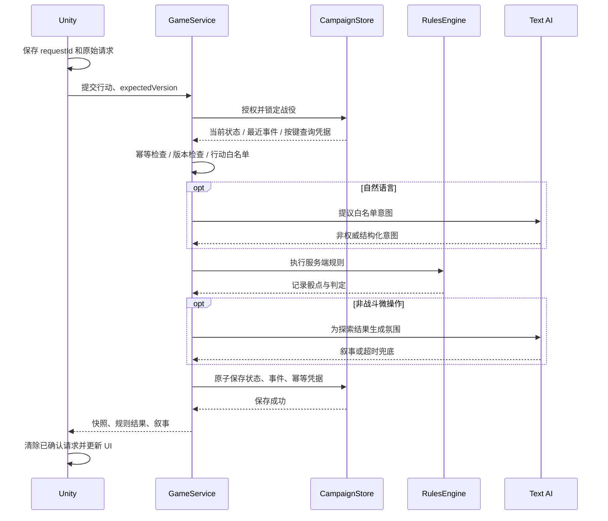

# DiceRealm 架构与推进顺序

> 当前优先级见 [当前状态](current-status.md)。本文保留既有架构解释；新增 Harness 与旧输入路径分开，由同一 .NET 领域层执行权威规则。

> 内容导入改造：生产流程已取消内置剧本和默认提示词，新战役保持空白。下文涉及雾港、灯塔、巡守等固定内容的部分是旧版回归场景记录，不再是启动默认值。当前入口、数据格式和限制以 [剧本与提示词导入](content-import.md) 为准；检定、资源、存档和权限规则仍由服务端执行。

---

### 技术选型

玩家客户端采用 Unity 6 LTS 的 2D/uGUI，主持工作台采用独立的浏览器 ES modules 前端，后端采用 .NET 10 ASP.NET Core。采用 C# 不代表把规则编译进客户端：客户端仅持有序列化 DTO 和展示状态，服务端单独管理所有规则、持久状态与外部模型调用。

旧参考版本是 Node/Express 与网页客户端。没有迁移旧状态管理、开发数据库、Prompt 存档或路由。原始参考和归档保持不动，新实现位于 [服务端](../server/DiceRealm.Server/) 和 Unity 工程。

先建立可玩闭环，再按实际行为增加资源、地图、战斗、角色、世界和协作模块。当前原型范围内的纵向功能已落地；未覆盖的规则明确进入裁定，不建立无行为的空框架。

---

### 模块职责

| 模块 | 接口与职责 | 不承担的职责 |
|---|---|---|
| [Domain](../server/DiceRealm.Server/Domain/) | 角色、导入场景、行动结果、d20 检定、内容校验与执行 | 网络、AI、Unity、文件操作 |
| [CombatEngine](../server/DiceRealm.Server/Domain/CombatEngine.cs) | 导入受限遭遇的先攻、回合、格子、攻击、NPC、资源与非致命恢复 | 通用战斗全规则、AI、网络 |
| [StandardCombat](../server/DiceRealm.Server/Domain/StandardCombat/) | 标准 2024 遭遇的先攻、几何、伤害、法术与专注，见 [标准战斗](standard-combat.md) | 网络、AI、Unity |
| [GameService](../server/DiceRealm.Server/Application/GameService.cs) | 创建、读取、提交行动、日志、生成快照 | 任意 AI 状态补丁、完整战斗 |
| [AdventureSessionService](../server/DiceRealm.Server/Application/AdventureSessionService.cs) | 无状态业务门面：授权转交与 DTO 投影，映射到 Harness/GameService，见 [冒险会话](adventure-sessions.md) | 状态、回执与事务（仍归内核服务） |
| [Rooms](../server/DiceRealm.Server/Domain/Rooms.cs) / [RoomService](../server/DiceRealm.Server/Application/RoomService.cs) | 8 位房间号与共享密码入房，见 [入房](room-onboarding.md) | 战役规则与角色状态 |
| [WorldMemory](../server/DiceRealm.Server/Domain/WorldMemory.cs) / [WorldMemoryService](../server/DiceRealm.Server/Application/WorldMemoryService.cs) | 世界记忆的存储与检索，见 [世界记忆存储](world-memory-storage.md) | 改写规则状态 |
| [内容创作](../server/DiceRealm.Server/Application/ContentAuthoringService.cs) | 提示词版本、静态检查、独立离线试跑、源战役只读授权 | 自动写故事、任意数值补丁、覆盖正式进度 |
| [Harness Run](../server/DiceRealm.Server/Application/HarnessRunService.cs) / [领域桥](../server/DiceRealm.Server/Application/HarnessGameService.cs) | opt-in 战役的运行、等待、恢复、授权工具与稳定回执 | 自行决定骰点、长事务内等待模型、替玩家同意 |
| [Agent Host](../agent-host/) | 显式资源的真实 Pi/MCP 循环；父回调访问模型与工具 | 开发者全局配置、coding 工具、任意路径/外部 MCP |
| [Harness 工作区](harness-workspace.md) | 不可覆盖的预设/Skill版本、明确激活、冻结记忆与一致导出 | 另一份游戏状态、会话回滚、隐式改写原文 |
| [AI ports](../server/DiceRealm.Server/Application/AiPorts.cs) | 意图、叙事、图片生成的独立接口 | 状态写入、规则决定 |
| [CampaignStore](../server/DiceRealm.Server/Infrastructure/CampaignStore.cs) | 授权、战役串行事务、SQLite 状态/事件/回执、一次性旧原型导入 | 叙事、多节点写入 |
| [MapCatalog](../server/DiceRealm.Server/Infrastructure/MapCatalog.cs) | 地图描述、地点关联、比较版本、原请求回执、发布权限、私有缓存 | 场景自动生图与角色状态写入 |
| [AssetCatalog](../server/DiceRealm.Server/Infrastructure/AssetCatalog.cs) | 只读旧场景图片 | 认领或重启旧任务 |
| [SceneReferences](../server/DiceRealm.Server/Infrastructure/SceneReferences.cs) | PNG 校验、内容地址、战役所有权、登记配额 | 任意路径读取、远程 URL 下载 |
| [MapWorker](../server/DiceRealm.Server/Infrastructure/ImageGeneration.cs) | 只执行已确认的地图任务、超时与租约检查 | 自动重试可能已计费的请求，或自动向玩家发布 |
| [API host](../server/DiceRealm.Server/Api/DiceRealmHost.cs) | HTTP、输入和错误映射、凭证、私有地图下载及旧公开图片兼容 | 客户端数值预测 |
| Unity Core | DTO、持久待确认请求、会话、缓存路径 | D&D 权威逻辑 |
| Unity UI | 场景、大厅、角色、地图、战斗与只读手记 | 主持表单、资源编辑、归档、权威数值 |
| [主持工作台](../client-workbench/) | PC 桌面内容创作、隔离试跑、邀请、DM 裁定、地图和历史；新 Harness 本人输入/确认；通过同源 API 写入 | 直接访问数据库、执行客户端权威规则 |

只在有真实替换需要的地方设接口：骰子生产/测试来源、离线/在线文本适配器、图片供应商。没有为所有普通方法再加一层空转发接口。

---

### 前端职责

游玩和管理分别由两个前端承载。Unity 冒险画面不创建主持表单；工作台仅作为另一种经过授权的 API 调用者。大厅、手记和角色页按使用时机分开，场景主画面不再展示所有服务端行动。具体入口与凭证安全见 [前端职责划分](frontend-separation.md)。

---

### 行动与提交语义

下图与后续同节描述既有行动路径。Harness 的模型循环在战役 gate 外执行，每个领域写入独立短事务，运行文件持久化模型/工具槽位；确认和恢复复用本人专用端点。完整状态机与恢复边界只维护在 [Harness 运行协议](harness-runtime.md)，不把下图的一次模型请求当成 Harness 全流程。

同一 `requestId` 的相同请求返回原始判定和当前快照，不再次调用规则或文本服务。相同 ID 携带不同内容返回 `idempotency_conflict`。不同请求携带旧版本返回 `stale_version`，不能自动把旧动作换成新 ID 重试。

同一战役的行动锁包含有时限的文本调用，第一阶段用串行语义换取清晰的一致性；不同战役可以并发。已取得锁并进入行动处理后，客户端断开不会取消提交。进程崩溃在原子提交前不会产生半份已保存结果，但也不承诺恢复尚未落盘的随机样本。重试保证针对已经提交的判定，不能宣称完整的崩溃前随机流重放。

当前不暴露随机种子。保存真实骰点用于回看，测试可注入固定骰子来源。没有把可预测的种子返回给联机玩家。

---

### 叙事与世界事实

规则结果、数值、路线、章节和事实由服务端决定。早期文本适配器返回 `{kind,target}` 意图或 `{text}` 氛围文本；后续输入理解与 Harness 已扩展受限候选、澄清和非机械世界记录。Harness 可多步调用授权工具，但仍不接收可写的 Campaign 对象，没有任意状态 patch。实际工具范围见 [运行协议](harness-runtime.md)，既有输入合同见 [输入驱动冒险](input-driven-adventure.md)。

路线、调查 DC、一次性行动、条件与后果来自已绑定的导入内容。早期点灯、沿岸分支等内容只作为回归夹具，不是平台默认冒险，也不声称来自 D&D 规则。场景摘要按已保存事实投影，不能因为章节变化自动生成图片。

复杂自然语言、未覆盖的战斗动作、施法和歧义输入进入待裁定记录。DM 裁定使用单独的带身份、规则引用、版本检查和审计事件的命令，不开放任意 JSON 状态覆盖。

---

### 内容创作与隔离试跑

创作草稿按服务、战役和席位保存在 IndexedDB（见 [剧本与提示词导入](content-import.md)）；[输入式准备](input-preparation.md) 与 [Harness 工作区](harness-workspace.md) 有各自隔离的草稿库和原请求恢复，不能混用。未明确提交的源文不会自动上传。导入文档随战役持久化，启用后固定剧本；提示词历史按内容哈希保存，不覆盖相同标识与版本的不同原文。切换绑定只改变后续请求，事件记录实际调用的版本，旧事件不补造信息。

试跑创建先授权并只读锁定源战役，再按源战役和请求编号派生独立战役编号。同一请求重放返回同一试跑，不能选择任意已有战役或覆盖正式进度。持久化的 `OfflineTrial` 在文本行动与地图生成入口强制检查，前端不能把它关闭。试跑自己的行动、资源和回执仍通过真实事务执行；静态可达性检查与试跑均不构成完整剧情可解性证明。

---

### 资源流程

场景快照不登记生图任务，旧图片只读。独立地图先保存草稿，再通过地图版本、请求 UUID 和费用确认进入队列。任务与游戏事务分开，不推进战役版本。

地图记录原子保存描述、状态、发布标记、认领租约与请求回执。启动时把残留 `generating` 标为失败，不重发可能已计费的请求；超时、断线和供应商错误也不自动重试。供应商身份改变时排队任务失败，旧回执不能重新触发后续失败。

缓存键包含用户原始提示词、请求尺寸、参考图顺序和供应商身份。实际输出尺寸单独保存；最终图片哈希与请求缓存键不同。新图片在私有目录，按战役和地图权限下载；只有审核发布的玩家版进入 Unity 图册。两个前端解码前核对大小、哈希与实际尺寸。

参考图由主持人登记、选择，只有独立的服务端开关明确允许外发后才用于 multipart 编辑。真实模型的大尺寸输出和制图质量没有保证。详见 [地图指南](maps.md)。

---

### 地点地图建议

主持工作台从战役已启用的剧本读取地点选项，独立地图记录保存关联。服务端按当前权威 `SceneId` 投影 `currentScene`，不把完整关联列表发送给玩家。该元数据不参与图片缓存身份，也不进入游戏状态事务的写入流程。

Unity 以席位和当前地点为选择上下文，换地点时优先关联图，同地点同步时保留手动选择。打开图册期间独立读取地图版本，撤下图片不依赖战役版本变化；未变化的纹理和列表按钮保持原实例。关联不改动探索路线，也不把地图像素当成战斗格子。使用方法见 [地图指南](maps.md)。

---

### 节点地图

[Adventure.Map](../server/DiceRealm.Server/Domain/Adventure.cs) 在同一个快照内投影已访问节点与当前合法 travel 目标。节点不携带完整场景文本、原始出口或隐藏条件；连线只表示当前可通行路线，不暴露完整拓扑。当前节点、已探索节点、未访问但可前往节点有不同展示状态。

Unity 的 地图面板 只渲染这个投影。点击仍调用原有的 `SubmitChoice("travel", target)`，复用持久待确认请求、版本检查和幂等回执。已访问地点不等于可以直接传送；服务端在行动事务内再次验证出口。

---

### 战斗切片

可空的 `Campaign.Combat` 保存先攻、队伍与巡守单位、独立预算、格子和战斗日志。玩家命令与其引发的 NPC 回合在同一原子事务内执行，响应里保留该次新增日志。场景图身份不随战斗步进变化。战斗/休息按钮不调用模型，战斗中复杂自然输入直接待裁定；未知命令仍拒绝。详见 [遭遇战](combat.md) 与 [标准战斗](standard-combat.md)。

历史固定预设仅做新增生命骰字段的兼容补齐，不恢复既有 HP 或 Second Wind，不重建角色 ID。不引入旧网页存档兼容。

---

### 长期存储与成本控制

[CampaignStore](../server/DiceRealm.Server/Infrastructure/CampaignStore.cs) 将全量事件和回执从每次加载的聚合中移到 SQLite 索引表，短事务原子提交。授权后迁移保留原 JSON，既有回执不丢弃。Unity 历史页面冻结读取截止点；回顾从已保存的事实投影，不另加模型成本。归档、导出与备份边界见 [长期存储](history-and-storage.md)。

[ProviderBudget](../server/DiceRealm.Server/Infrastructure/ProviderBudget.cs) 在供应商 HTTP 前持久预留调用次数，限制战役日额、全局日额与全局累计额。它与游戏事务分开，所以失败动作或供应商故障不会退回已经尝试的成本额度。地图与旧场景历史共用持久额度账本；首次进入场景不再调用图片供应商。详见 [地图管线](maps.md)。

---

### 可继续扩展的范围

当前开发版已覆盖原计划的可玩闭环、节点探索、角色与成长、可导入受限遭遇与任务分支、持久历史、协作、地图图册、PC 界面和内容创作工具。一级单职业建卡已由独立的目录、来源选择解析、纯评估与客户端草稿模块实现，见 [完整建卡流程](full-character-creation.md)。1–20 级与多职业升级已由 [AdvancementService](../server/DiceRealm.Server/Application/AdvancementService.cs) 和 [Domain/Advancement](../server/DiceRealm.Server/Domain/Advancement/) 实现，见 [角色成长](character-advancement.md)。后续可扩展更多职业能力执行与遭遇、通用反应窗口、更多法术、账户/服务器推送、缓存淘汰和对象存储。每个规则增量仍需取证与测试，不把可检索的完整 D&D 数据当成已经执行的规则。

---

### 成员上下文

[PartyEngine](../server/DiceRealm.Server/Domain/PartyEngine.cs) 保留原角色为队长，为每个队员保存独立角色与凭证哈希。存储层验证请求凭证后设置不可序列化的 `ActingActorId`；角色引擎通过 `ActingCharacter` 访问明确的角色，保存时不会把队员写入队长字段。剧情物品和奖励保持队长单次领取。战斗 NPC 以明确的目标单位更新角色，不靠临时交换全局角色实现。

请求幂等键、Unity 待确认文件和本机存档均按席位隔离。GET 轮询仅在空闲、无待确认请求且会话代次未变化时应用更高版本，避免旧读取覆盖新行动或另一席位。邀请和 DM 命令在原有事务内记录审计，权限与边界见 [协作说明](party-and-rulings.md)。
