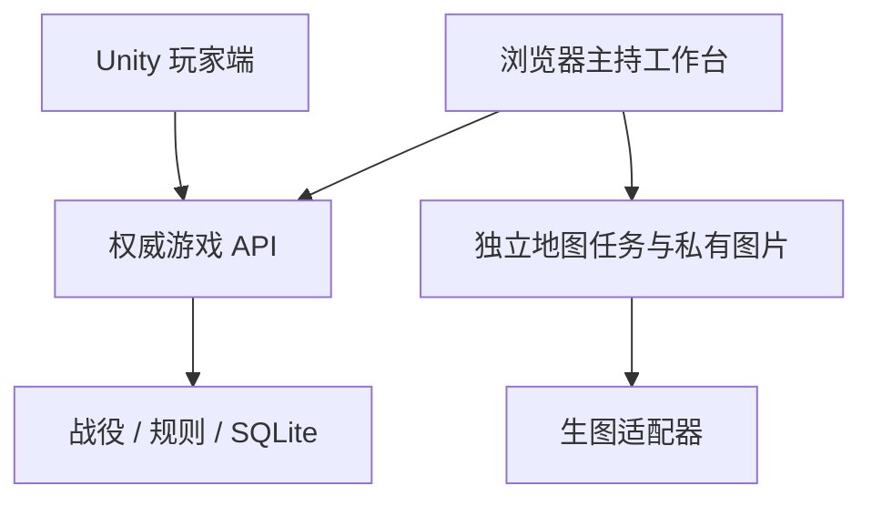

# 玩家端与主持工作台

DiceRealm 的界面按使用者和使用时机划分。既有战役游玩在 Unity 中进行；主持、资源准备、战役管理及新战役的本人行动使用 PC 桌面浏览器工作台。前端只表达[业务冒险与内容设定](adventure-sessions.md)，不提供 Harness、Run 或执行引擎选择；底层执行内核和旧 HTTP 兼容仍在服务端（见 [Harness 运行](harness-runtime.md)）。Unity 已接入同一业务冒险链，并保留旧战役兼容。两个前端共用权威服务端，不复制战役状态或规则。

---

### Unity 玩家端

AdventureShell 负责玩家页面组合，AdventureHud 实现完整场景背景、左侧队伍栏（BG3 头像加 HP 徽章，不画生命条）、底部行动坞和展开阅读层。顶端提供地图、手记和菜单。叙事与判定分别打开阅读，长历史不常驻主画面。视觉与布局规则见 [Unity 前端规范](../.trellis/spec/frontend/unity.md)。

场景行动只显示当前地点可做的事。PlayerActionPresentation 将换装、施法、休整和成长放到角色页，将战斗命令放到棋盘。它只分配服务端已有按钮的展示位置，不生成新的合法行动。

键鼠入口为 C 角色、I 背包、M 地图、J 手记、Esc 返回或打开菜单；输入框编辑与输入法组合期间不响应字母导航。正文字号只在设置（F10）中调整，与辅助界面放大分开。默认使用 PC 列表密度，说明通过紧凑悬停或 F1 完整阅读。

地图页保留原探索路线，并提供独立玩家图册。图册仅鉴权读取已发布的玩家版，缩放和叠加网格不改变游戏规则。

手记仅提供历史原文、冒险回顾、任务与人物。历史原文默认最近页、页内从新到旧；冒险回顾阅读已保存的故事，不混入任务清单。任务与人物按任务/人物/地点/线索/势力/抉择分类成卡片，搜索限定当前分类。独立同行伙伴页已移除，同伴资料仍可从头像只读打开。战役只由工作台创建。游玩端的冒险菜单提供加入房间、读取本机战役，设置中导入本人连接；加入时仍可完整建卡、恢复草稿。Unity 不保留战役创建表单或调用，不与冒险行动混排。

---

### 浏览器主持工作台

[client-workbench](../client-workbench/) 是独立的 HTML、CSS 和 ES module 前端，不依赖 Unity。服务端将其公共文件嵌入构建产物，入口为 `/workbench/`。不需要再运行一个 Node 服务，也不需要启用跨域访问。

工作台只保留 DM 要用的页面：剧情（默认页）、世界记录、剧本与提示词，管理员另有请求日志与 AI 设置。旧书签路由保留为别名，不另设导航。视觉与布局规则见 [工作台样式规范](../.trellis/spec/frontend/workbench-style.md)，AI 接口配置见 [AI 设置规范](../.trellis/spec/backend/ai-settings.md)。按 PC 桌面键鼠设计，只保留桌面窗口缩放与阅读放大的可用性，不开发或验收 H5／手机适配。裁定、席位撤销继续使用现有服务端权限和事件记录；界面不能修改骰点或直接写入世界事实。

Unity 主持席位可从大厅打开工作台。浏览器地址不带 token。连接文件包含完整队长凭证，需在 Unity 中明确确认后导出，再由使用者在浏览器中选择导入；不要分享该文件，使用后可删除。也可手动输入战役编号与访问凭证。导入必须与当前服务来源一致，不会自动把凭证发送到另一个服务器。

既有战役的正式冒险行动仍由 Unity 发起；新战役的 `#/adventure` 是「我的行动」业务页，允许主持及已获批准队员提交本人的行动、回答和明确确认，不放宽主持管理权限。`#/content-settings` 是 `#/prepare/settings`（叙事设定）的别名，属于内容准备，保存草稿、发布、启用分开操作；不展示内核哈希或要求选择引擎。GET/重连不自动调用模型。内容页另有隔离试跑，使用独立凭证和数据库，服务端永久禁止其模型调用，不接受正式战役连接代替试跑。

浏览器凭证、本人行动草稿、试跑连接和普通游戏未确认请求保留在当前标签页的 `sessionStorage`，不作为跨设备账号系统。准备及内容设定草稿另用 IndexedDB，兼容旧工作区草稿记录；详见[业务冒险与设定](adventure-sessions.md)。关闭标签页会清除会话，不会替你找回凭证。不要在请求未确认时关闭标签页，先重试原请求以确认结果。

---

### 同步与故障恢复

Unity 对单人战役也进行空闲轮询，因此工作台完成裁定或归档后，玩家端不必重新载入存档。忙碌或有未确认行动时不应用背景读取；会话代次和版本检查防止旧读取覆盖新状态。

工作台的管理写入必须先保存原请求，再发送。网络中断或服务端暂时失败时保留原 payload，重试不能产生新的请求 ID、骰点或费用确认。收到明确的版本冲突后重新读取状态，再由使用者决定下一步。

仅打开工作台和读取页面不会安排付费生成。保存地图描述不调用模型；生成和失败后重新生成必须明确确认可能使用供应商额度。图片失败不会阻塞游玩。

---

### 验证入口

PlayerSplitLoop 使用真实 HUD 回调验证大厅、角色行动、主画面按钮归属、手记与待裁定提交，并验证浏览器裁定后的单人同步。只允许连接离线测试服务。

[WorkbenchTests](../tests/DiceRealm.Tests/WorkbenchTests.cs) 检查静态文件、内容类型、安全响应头、目录隔离和 API 权限。工作台协议与重试测试位于 [client-workbench](../client-workbench/)；运行方式见其说明。界面验收流程见 [验证规范](../.trellis/spec/verification.md)。

旧的 Unity 资源、邀请、DM 和归档冒烟脚本属于前一版单客户端界面，不能作为当前导航验收。它们的历史结果仍可用于追溯服务端功能，不应据此声称当前界面已经通过测试。
